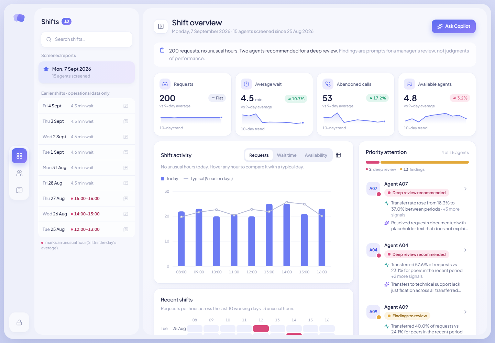
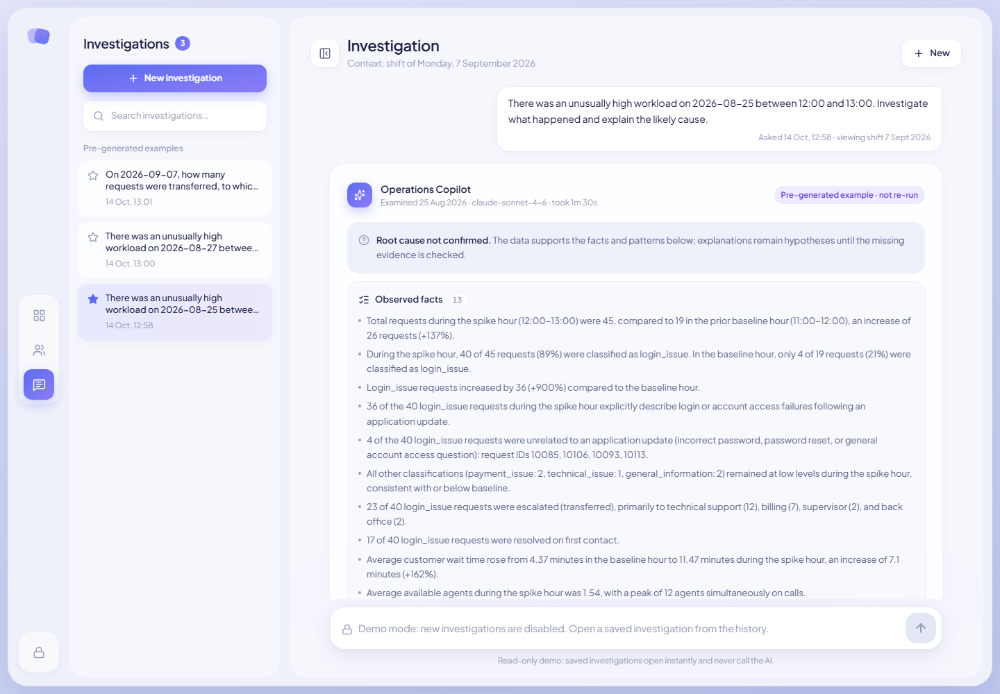
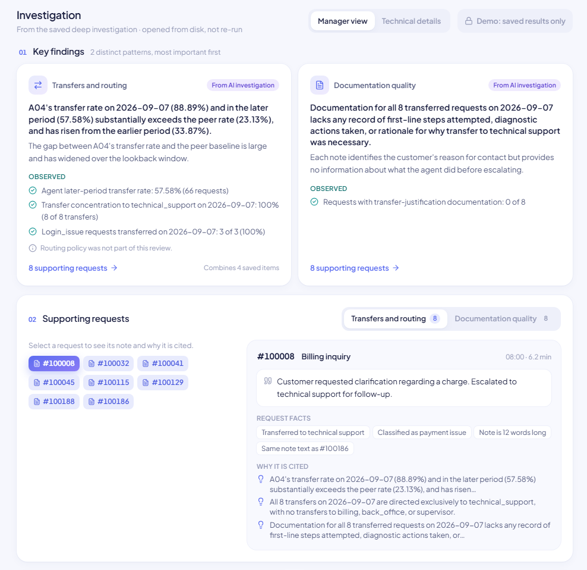
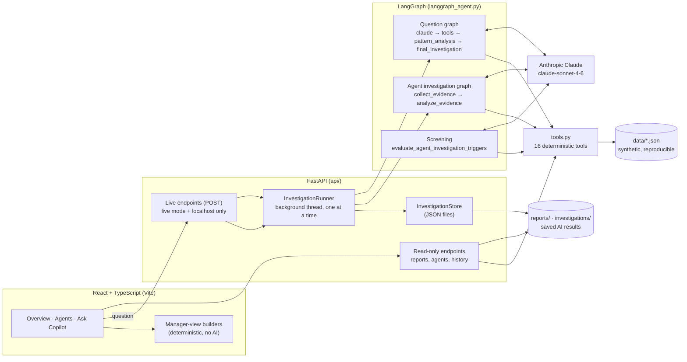
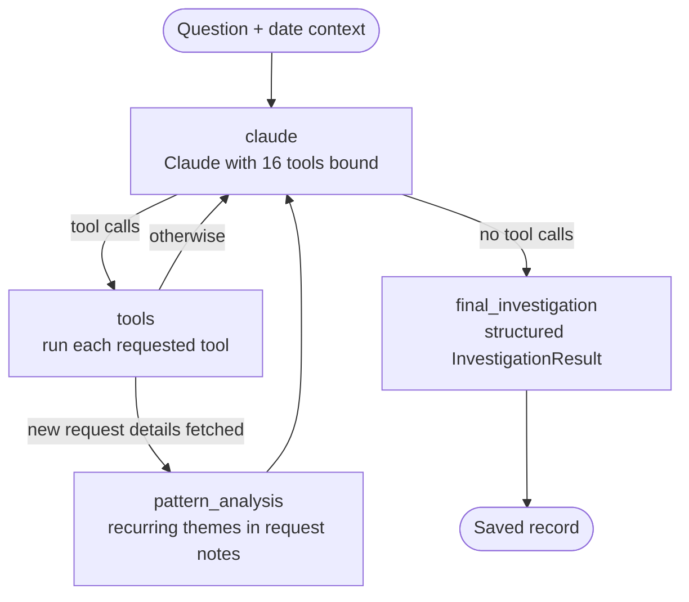
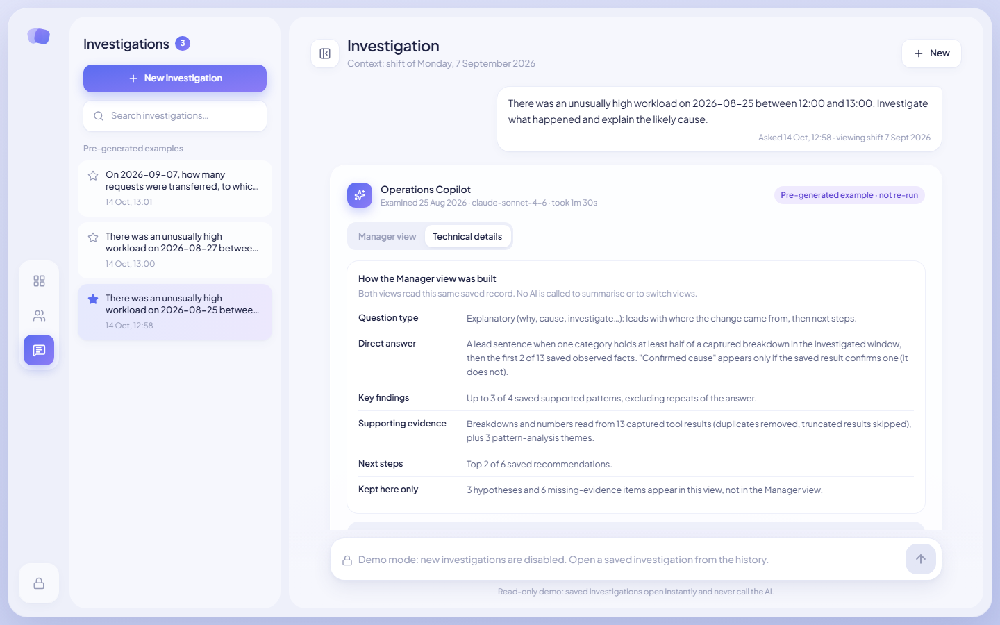
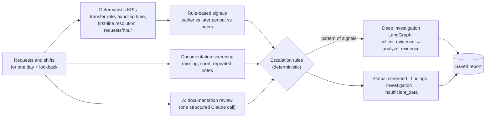
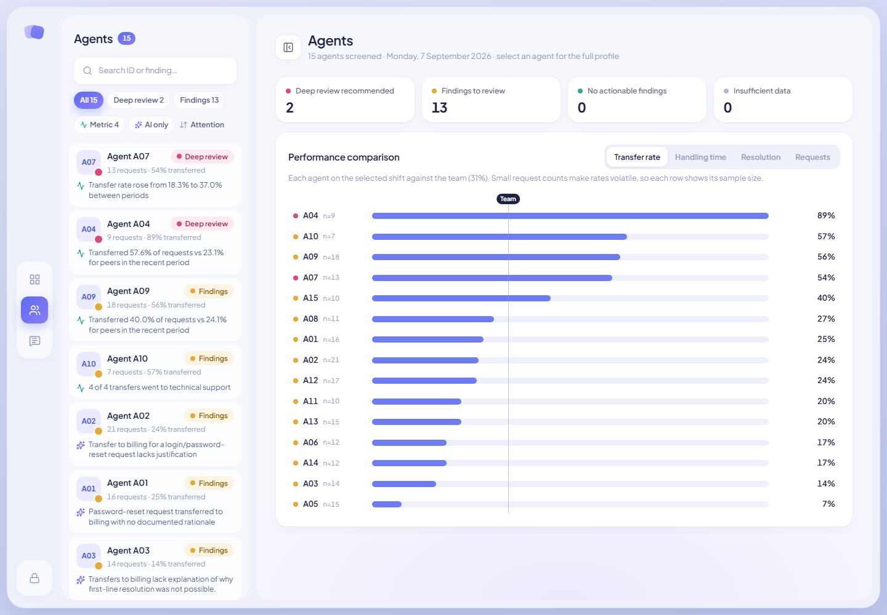
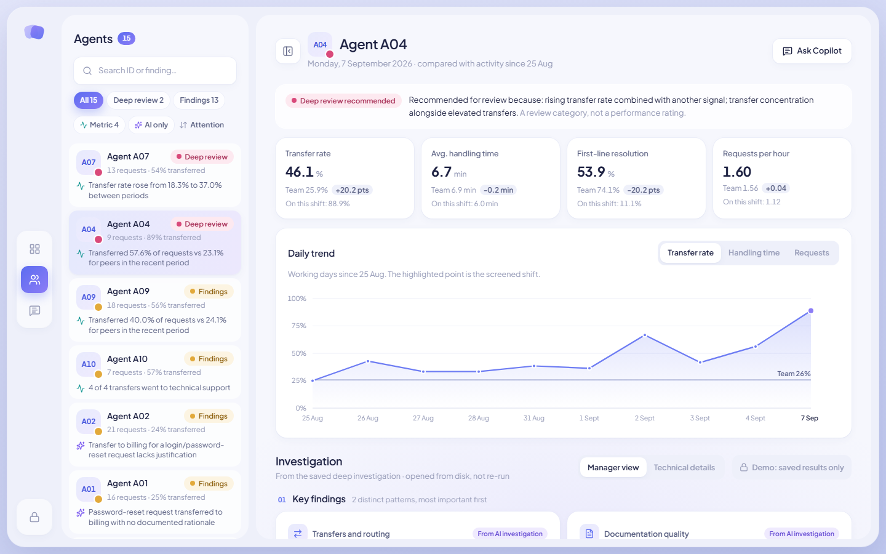

# Operations Copilot

**An AI investigation workspace for service-center managers.** It monitors the
day's operations, screens every representative's performance, and answers
operational questions in natural language using a LangGraph agent that calls
deterministic data tools and separates facts from hypotheses.

> All data in this repository is **synthetic** and models a generic customer-support
> desk. No real people, customers, organizations or operational records are included.



---

## Contents

- [The problem](#the-problem)
- [Why it matters](#why-it-matters)
- [What it does](#what-it-does)
- [Architecture](#architecture)
- [Technology stack](#technology-stack)
- [The AI tools](#the-ai-tools)
- [How the AI works](#how-the-ai-works)
- [Agent Performance Monitoring](#agent-performance-monitoring)
- [Example questions and outputs](#example-questions-and-outputs)
- [Getting started](#getting-started)
- [Running the tests](#running-the-tests)
- [Security and privacy](#security-and-privacy)
- [Project structure](#project-structure)
- [Limitations and next steps](#limitations-and-next-steps)
- [Background](#background)

---

## The problem

A service-center manager running a large team needs fast answers to three questions:

1. **What happened in my center today?** Volume, wait times, abandoned calls, unusual hours.
2. **Which representatives or patterns need attention?** Transfer rates, handling time,
   documentation quality, and how they are changing.
3. **What is the evidence, and what should I check next?**

Dashboards answer the first question but not the "why". A general chatbot can answer
"why", but it may invent numbers. This project combines the two: **deterministic code
computes every number**, an **LLM agent decides which numbers to look at and interprets
them**, and every claim is traceable to the tool call that produced it.

## Why it matters

- **From "what" to "why" in one place.** A manager can ask a question in plain language and get
  an investigation built on the underlying records, instead of a dashboard to interpret alone.
- **Checkable numbers.** Calculations are done by deterministic, unit-tested tools, and the agent
  is instructed to base every figure on their results. The saved trace shows each tool call and
  its output, so any number in an answer can be checked against its source.
- **Evidence before conclusions.** Answers are structured to separate observed facts from
  hypotheses and to name the missing evidence; the root-cause field stays empty unless the
  evidence directly confirms one.
- **Fair attention to people.** Performance screening uses fixed, explainable rules and links
  every finding to the requests behind it. Results are prompts for a manager's review, not
  ratings, and the AI cannot escalate anyone on its own.
- **Auditable and safe to share.** Every investigation keeps a full trace of tool calls, and
  demo mode lets anyone explore the results without an API key or any AI cost.

## What it does

| Screen | Purpose |
|---|---|
| **Overview** | The day's KPIs against the previous working days, hourly activity against a typical day, a 10-day heatmap with unusual hours, and a short list of representatives who need attention. |
| **Agents** | A searchable, filterable directory of every representative, a team comparison, and a profile per representative: metrics against the team, daily trends, rule-based signals, AI observations on their notes, and a saved deep investigation. Each investigation has a concise **Manager view** and a full **Technical details** audit view. |
| **Ask Copilot** | Ask an operational question. The LangGraph agent investigates with the data tools and returns observed facts, supported patterns, hypotheses, missing evidence and recommendations. Every investigation is saved to a searchable history and reopens without calling the AI again. |

**Demo mode and live mode.** By default the app runs in **demo mode**: it is read-only and
serves saved, pre-generated AI results, so it needs no API key and costs nothing. **Live mode**
(`APP_MODE=live` plus an API key) lets the local machine run new AI investigations.

| Ask Copilot (Manager view) | Agent investigation (Manager view) |
|---|---|
|  |  |

---

## Architecture



**Design principle: precompute, then serve.** Opening a page never calls the AI. The
screening report and the example investigations are generated ahead of time by scripts and
saved as JSON, and the API serves them together with numbers recomputed by deterministic
code. Only an explicit action in live mode starts a paid AI run.

### Main components

| Component | Responsibility |
|---|---|
| `tools.py` | All deterministic calculations over the synthetic data: counts, breakdowns, wait times, monitor metrics, per-agent KPIs, trends, rule-based signals, documentation screening, and agent comparison. No AI. |
| `langgraph_agent.py` | The AI layer: LangChain tool wrappers, the system prompt, Pydantic output schemas, the two LangGraph graphs, AI documentation review, screening rules, the daily screening report, and a CLI. |
| `api/` | FastAPI app: read-only endpoints, live endpoints behind safety checks, a background runner, and persistent investigation history (`copilot_store.py`). |
| `web/` | React + TypeScript single-page app. `managerSummary.ts` and `copilotSummary.ts` build the concise Manager views from saved results without calling the AI. |
| `scripts/` | `generate_report.py` (daily screening report, paid) and `generate_examples.py` (demo investigations, paid). |
| `generate_demo_data.py` | Generates the synthetic dataset. Seeded, so it reproduces the committed data byte-for-byte. |
| `app.py` | The original Streamlit prototype, superseded by `web/`. Kept for reference; it runs the agent but does not render structured results. |
| `agent.py` | The original agent prototype, retained for reference: a hand-written tool-use loop on the Anthropic SDK (up to 5 steps) over three early tools. Those tools were later replaced in `tools.py`, so this file no longer runs as-is; the current agent is `langgraph_agent.py`. |
| `app_old.py` | An early script that called the tools directly and printed their output for the 25 Aug spike. Retained for reference. |
| `data backup/`, `data/*_old.json`, `data/monitor.json` | Earlier versions of the synthetic dataset, retained for reference. The application reads only `requests.json`, `monitor_snapshots.json` and `agent_shifts.json`. |

---

## Technology stack

Versions are the ones pinned in `requirements.txt` and `web/package.json`.

| Layer | Technology |
|---|---|
| LLM | Anthropic Claude `claude-sonnet-4-6`, temperature 0, via `langchain-anthropic` 1.4.8 (Anthropic SDK 0.117) |
| Agent orchestration | LangGraph 1.2.9, LangChain Core 1.4.9 |
| Structured output and validation | Pydantic 2.13 (`with_structured_output`) |
| Backend API | FastAPI 0.143, Uvicorn 0.53, Python 3.12 |
| Frontend | React 19, TypeScript 6, Vite 8, Tailwind CSS 4, React Router 7, Lucide icons |
| Charts | Hand-written SVG components (no chart library) |
| Storage | JSON files behind a small storage interface (no database) |
| Tests | pytest 9, FastAPI `TestClient`; TypeScript strict mode and oxlint for the frontend |

---

## The AI tools

The agent can call 16 tools. Each is a thin LangChain `@tool` wrapper in
`langgraph_agent.py` around a plain Python function in `tools.py`, so all arithmetic is
deterministic and unit-testable. The tool's docstring is what Claude reads to decide when
to use it.

| Tool | Inputs | Returns |
|---|---|---|
| `count_requests` | `start_time`, `end_time` | Number of requests in the window |
| `get_requests_by_classification` | `start_time`, `end_time` | Request counts per category (login, payment, technical, general information) |
| `get_classification_count` | `start_time`, `end_time`, `classification` | Count for one category |
| `get_requests_by_status` | `start_time`, `end_time` | Resolved vs transferred counts |
| `get_transfers_by_destination` | `start_time`, `end_time` | Transfers per destination team |
| `get_classification_status_breakdown` | `start_time`, `end_time`, `classification` | Statuses and transfer destinations for one category |
| `get_requests_by_time_bucket` | `start_time`, `end_time`, `bucket_minutes` | Request counts per time bucket (spike shape) |
| `get_request_details` | `start_time`, `end_time`, optional `classification` | Request IDs, subjects and notes for semantic analysis |
| `get_average_wait_time` | `start_time`, `end_time` | Average customer wait time |
| `get_monitor_metrics` | `start_time`, `end_time` | Available agents, peak agents on calls, answered and abandoned calls |
| `compare_values` | `current`, `baseline` | Absolute and percentage change |
| `get_agent_performance` | `agent_id`, `start_date`, `end_date` | One representative's KPIs plus the team baseline |
| `get_agent_daily_trends` | `agent_id`, `start_date`, `end_date` | Per-day requests, transfer rate, resolution rate, handling time |
| `detect_agent_performance_signals` | `agent_id`, `start_date`, `end_date` | Rule-based signals comparing earlier vs later periods and peers |
| `get_agent_request_evidence` | `agent_id`, dates, optional filters, `limit` | Request-level evidence for one representative |
| `get_agent_comparison` | `start_date`, `end_date` | Every representative's KPIs and per-category transfers, sorted by transfer rate, plus the list of valid agent IDs |

The four per-agent tools validate `agent_id` against the real roster (`A01`–`A15`). An
unknown ID returns an error that lists the valid IDs, so the agent can correct itself.

---

## How the AI works

### Ask Copilot: the question graph



1. **Request in.** `POST /api/copilot/investigations` checks that live mode is on, an API
   key is configured, the client is this machine, no proxy headers are present, and no other
   investigation is running. It saves a `running` record immediately and returns.
2. **Date context.** The question is stored exactly as typed. The agent receives it plus one
   line such as *"The manager is viewing the shift of 2026-09-07; treat 'today' as that date.
   Available data covers 2026-08-25 to 2026-09-07."* This line is saved for audit.
3. **Interpretation and tool choice.** The `claude` node sends the system prompt and the
   conversation to Claude, which has the 16 tools bound (`bind_tools`). Claude decides which
   tools to call, often several in parallel, based on the question and the tool descriptions.
   The system prompt sets the rules: base facts only on tool results, never invent data or
   identifiers, separate facts from hypotheses, and never claim causation without direct evidence.
4. **Tool execution.** The `tools` node runs each requested tool. Results go back to Claude as
   tool messages. **If a tool fails** (for example an invalid agent ID), the error is returned
   to Claude as an error result instead of stopping the run, and the other calls still run.
5. **Pattern analysis.** When the agent fetches request notes, a separate structured call
   (`PatternAnalysisResult`) groups them into recurring themes, each with supporting request
   IDs and a confidence level. The themes are fed back to Claude as evidence, not as causes.
6. **Final answer.** When Claude stops calling tools, `final_investigation` makes one
   structured call that files an `InvestigationResult`: `observed_facts`,
   `supported_patterns`, `hypotheses`, `confirmed_root_cause` (null unless directly
   proven), `missing_evidence` and `recommendations`.
7. **Persistence and display.** The runner saves the result, the pattern themes, the final
   prose answer, the date range examined and a trace of every tool call with its arguments and
   result. The UI polls until the run finishes. The Manager view is built from this saved
   record by deterministic code; the Technical view shows all of it.



### Error handling and edge cases

| Case | Behaviour |
|---|---|
| Invalid agent ID or other tool error | Returned to Claude as an error result; the agent can retry or explain. Covered by regression tests. |
| Runaway loops | LangGraph recursion limit of 40 steps per run. |
| Claude or network failure mid-run | The record is saved as `failed` with the error type and message, and keeps the tool calls made before the failure. |
| Server restart during a run | On startup, any record still `running` is marked `failed` ("Interrupted"). |
| Duplicate submissions | The button locks while a run is active, and the server allows one run at a time (HTTP 409 otherwise). |
| Hallucinated evidence | The agent investigation and the documentation review both reject results that cite request IDs not present in the evidence, or a different agent or date. |
| Large tool results | Saved traces keep up to 16,000 characters per result; the agent itself always receives the full result. |
| Missing or corrupt saved files | The API returns clear 404, 500 or 503 responses without file paths; a corrupt history file is skipped. |

### Deterministic code vs LLM reasoning

| Deterministic (Python / TypeScript) | LLM (Claude) |
|---|---|
| Every count, rate, average, comparison and trend | Choosing which tools to call, and in what order |
| Signal thresholds and the escalation rules | Reading request notes and spotting recurring themes |
| Validating IDs and cited evidence | Interpreting the evidence and proposing hypotheses |
| The Manager-view summaries in the UI | Structuring the findings into the output schema |
| Access control, persistence and run tracking | Writing recommendations proportionate to the evidence |

---

## Agent Performance Monitoring

**Status: implemented.** It runs end to end on the synthetic dataset. It combines
deterministic KPI calculations, rule-based screening, AI review of documentation, and an
LLM-driven deep investigation. Results are generated by a batch script and served by the
**Agents** screen.



**What is computed per representative** (`tools.py`): handled requests, transfer rate,
first-line resolution rate, average handling time, requests per scheduled hour, transfer
destinations, daily trends, and documentation statistics (missing notes, notes under six
words, identical repeated notes).

**Rule-based signals** (`detect_agent_performance_signals`, `evaluate_agent_investigation_triggers`).
The lookback window's working days are split into an earlier and a later half:

- Transfer rate at least 15 points above peers in the later period (both the representative and
  the peers need at least 20 requests in that period).
- Transfer rate rising by at least 15 points between periods, and average handling time changing
  by 20% or more in either direction. Both rules need at least 20 requests in each period;
  a 20% drop in handling time together with a 15-point rise in transfers is a separate signal.
- Many short notes on the screened day: at least five requests, at least three notes under six
  words, and at least 40% of the day's notes under six words. Two or more missing notes is a
  separate signal.
- Transfers concentrated on one destination on the screened day: at least four transfers, with
  one destination receiving at least three of them and at least 75%.
- With fewer than four scheduled working days in the lookback, the trend signals above are
  skipped (the performance check reports `insufficient_data`); the day's documentation and
  transfer checks still run. The representative's overall status is `insufficient_data` only
  when they handled no requests on the screened day.

**AI documentation review** (`analyze_agent_documentation`): Claude reads every note from
the day and reports documentation gaps with supporting request IDs. Its prompt says that
short or repeated notes are not problems by themselves. A finding citing an unknown request
ID is rejected.

**Escalation is deterministic.** Only these combinations of rule-based signals produce the
status `investigation`, which triggers a deep investigation:

- faster handling combined with more transfers;
- a rising transfer rate together with a high rate versus peers, many short notes, or missing notes;
- many short notes when at least 70% of the day's notes are short, or when notes are also missing;
- concentrated transfers together with a rising transfer rate or a high rate versus peers.

Any other signal, including an AI documentation observation, gives `findings`; no signal at all
gives `screened`. An AI observation alone cannot escalate a representative.

**Deep investigation** (`agent_investigation_graph`): a deterministic node collects
performance, daily trends and every request of the day, then one structured Claude call returns
an `AgentInvestigationResult` (summary, observed facts, findings with supporting metrics and
request IDs, hypotheses, missing evidence, recommendations). The agent ID, date and cited
request IDs are validated against the evidence.

**In the UI**, each representative has a **Manager view** that groups overlapping findings into
two to four themes, shows measured facts first, and links every finding to the requests behind
it, plus a **Technical details** view with the complete saved record and how the summary was derived.

| Agents directory and team comparison | Representative profile |
|---|---|
|  |  |

**Current scope and limits.** The committed report covers one day (2026-09-07, 15
representatives: 2 recommended for a deep review, 13 with findings). Thresholds are exploratory
and tuned on synthetic data, not validated against real outcomes. Screening statuses are review
prompts for a manager, **not** performance ratings. In this synthetic data, transfer notes use a
fixed template, so the AI review flags documentation gaps for almost every representative; the UI
therefore separates rule-based metric signals from AI-only observations.

---

## Example questions and outputs

All outputs below come from real runs of the agent on the synthetic data. The first three
are committed in `investigations/examples/` and open in the app without an API key.

**1. "There was an unusually high workload on 2026-08-25 between 12:00 and 13:00. Investigate what happened and explain the likely cause."**
13 tool calls (counts, classifications, time buckets, monitor metrics, wait times, request
details, comparisons). Manager view:

> **The volume was concentrated in login issue requests: 40 of 45 (89%), 25 Aug 12:00–13:00.**
> - 45 requests in the spike hour vs 19 in the previous hour (+137%).
> - Login issue requests increased by 36 (+900%).
> - Pattern analysis: 36 of 40 login requests describe access failures after an application update.
>
> Root cause: not confirmed. Hypothesis (Technical view): an application release around 12:00
> introduced a login defect. Missing evidence: deployment and release logs.

**2. "There was an unusually high workload on 2026-08-27 between 15:00 and 16:00. Investigate what happened and explain the likely cause."**
45 vs 20 requests (+125%). Payment requests were the largest category (16), average wait
12.49 minutes, and available agents averaged 0.77. The agent's leading hypothesis was a payment
system event. The scenario planted in the generator for this hour was a **staffing shortage**:
the low agent availability was in the facts, but the hypothesis pointed elsewhere. It is kept
as an honest example of why hypotheses are labelled as unconfirmed.

**3. "On 2026-09-07, how many requests were transferred, to which destinations, and which request classifications were most often transferred?"**
7 tool calls. 200 requests; 61 transferred (30.5%); destinations: technical support 35,
billing 13, back office 11, supervisor 2. Login issues had the highest transfer rate (36.4%).

**4. "Which agents had the highest transfer rates on September 7, 2026, and what might explain the differences between them? Are the higher transfer rates related to specific request categories?"**
This question first exposed a real bug: no tool listed the representatives, so the agent guessed
IDs (`A001`) and the tool error aborted the run. After adding `get_agent_comparison`, ID
validation and recoverable tool errors, the same question completed in a local live run
(11 tool calls) using `get_agent_comparison`. The data shows A04 at 88.89% (8 of 9 transferred,
all payment and login requests) against a team rate of 30.5%. That run is not committed;
the failure and the recovery path are covered by regression tests.

**Other questions the tools support:** "Compare customer wait time on 2026-09-07 with
2026-09-04", "Which request types drove today's workload?", "Did agent A07's performance
change between August 25 and September 7?".

---

## Getting started

### Prerequisites

- Python 3.12
- Node.js 20.19 or newer (tested with 24)
- Optional, for live mode only: an Anthropic API key

### 1. Backend

```bash
python -m venv .venv
# Windows:      .venv\Scripts\activate
# macOS/Linux:  source .venv/bin/activate
pip install -r requirements.txt
cp .env.example .env            # Windows PowerShell: Copy-Item .env.example .env
uvicorn api.main:app --reload
```

The API runs at http://127.0.0.1:8000 (interactive docs at http://127.0.0.1:8000/docs).

### 2. Frontend (in a second terminal)

```bash
cd web
npm install
npm run dev
```

Open **http://127.0.0.1:5173**. The frontend proxies `/api` to the backend.

> **Windows note:** if PowerShell blocks `npm` ("running scripts is disabled"), use
> `npm.cmd install` and `npm.cmd run dev`. No execution-policy change is needed.

### Demo mode (default)

With `APP_MODE=demo` (or unset), the app is fully usable without an API key: every screen
works, and Ask Copilot opens the saved example investigations. New investigations are
refused by the server.

### Live mode (local only)

1. Put your key in `.env` (never in code):
   ```
   APP_MODE=live
   ANTHROPIC_API_KEY=your-key-here
   ```
2. Restart the backend. The lock icon in the left rail becomes a lightning icon.
3. Ask a question in Ask Copilot, or run a deep investigation from an agent's profile.
   Each run makes paid API calls (typically 5–12 Claude calls).

To change or rotate the key, edit `.env` and restart the backend. Return to demo mode by
setting `APP_MODE=demo` and restarting.

### Optional: regenerate data and AI artifacts

```bash
python generate_demo_data.py                  # synthetic data (reproduces data/ exactly)
python scripts/generate_report.py 2026-09-07  # daily screening report (paid)
python scripts/generate_examples.py           # Ask Copilot examples (paid)
python langgraph_agent.py                     # CLI: ask a question or build a daily summary (paid)
```

---

## Running the tests

```bash
python -m pytest -q          # backend: 56 tests, no API key or network needed
cd web
npm run lint                 # oxlint
npm run build                # TypeScript strict type-check + production build
```

The backend tests never call Claude. The LangGraph tests replace the model with a scripted
fake, which lets them reproduce exact agent behaviour, including the invented-ID failure above.

| Test file | Covers |
|---|---|
| `tests/test_api.py` | Read-only endpoints, demo default, bad input (404/422), corrupt files, response shapes, rule vs AI separation, cited-request evidence |
| `tests/test_copilot.py` | Live-mode safety gates (demo, missing key, remote client, proxy headers), one run at a time, persistence, reopening without re-running, failures, interrupted runs, trace capture |
| `tests/test_agent_tools.py` | Agent comparison correctness, agent ID validation, tool-error recovery, the exact failing question end to end, partial traces on failure |

---

## Security and privacy

- **No secrets in code or history.** The Anthropic key is read from the environment
  (`.env`, git-ignored). The history has been scanned for key patterns, and `.env` was never committed.
- **The browser never sees the key.** The frontend calls only the local API; `/api/config`
  returns the mode, never credentials.
- **Paid endpoints are local-only.** New investigations require `APP_MODE=live`, an API key,
  a loopback client address and no proxy headers. Both dev servers bind to `127.0.0.1`.
  A public deployment would need authentication and per-user history first.
- **Untrusted text.** Request notes are passed to the model as data, and the prompts say so.
- **Synthetic data only.** Generated with a fixed seed; contains no names, contact details
  or real records. Representatives are identified only as `A01`–`A15`.

---

## Project structure

```
.
├── langgraph_agent.py        # AI layer: tools, prompts, schemas, LangGraph graphs, screening, CLI
├── tools.py                  # deterministic data tools (no AI)
├── generate_demo_data.py     # seeded synthetic data generator
├── app.py                    # original Streamlit prototype (superseded by web/)
├── agent.py                  # original agent prototype: Anthropic SDK tool loop (reference only)
├── app_old.py                # early tool-testing script (reference only)
├── data backup/              # earlier versions of the synthetic data (reference only)
├── api/
│   ├── main.py               # FastAPI app and read-only endpoints
│   ├── service.py            # builds responses from saved reports + tools
│   ├── shift.py              # hourly activity and daily trends
│   ├── storage.py            # reads and validates saved reports
│   ├── copilot_routes.py     # Ask Copilot endpoints and live-mode safety gates
│   ├── copilot_runner.py     # background runs of the LangGraph workflows
│   ├── copilot_store.py      # investigation history (JSON implementation)
│   ├── schemas.py            # Pydantic response models
│   └── config.py             # settings and demo/live mode
├── web/src/
│   ├── features/overview/    # Overview screen
│   ├── features/agents/      # Agents directory, profiles, managerSummary.ts
│   ├── features/copilot/     # Ask Copilot, history, copilotSummary.ts
│   └── components/           # layout, charts, shared UI
├── data/                     # synthetic requests, monitor snapshots, shifts (+ older *_old.json versions)
├── reports/                  # saved daily screening report (AI output)
├── investigations/examples/  # saved example investigations (AI output)
├── scripts/                  # paid generation scripts
├── tests/                    # pytest suite
└── docs/screenshots/
```

---

## Limitations and next steps

- **Synthetic data only.** Thresholds and prompts were tuned on generated data and have not
  been validated against real operations.
- **No formal evaluation set.** The generator's planted scenarios (`data/demo_ground_truth.json`)
  could become an automatic evaluation of the agent's conclusions; example 2 shows why that matters.
- **JSON storage and a single worker.** Fine for one local user. A shared deployment would need a
  database behind the existing `InvestigationStore` interface, a job queue, authentication and
  per-user history.
- **One screening day is committed.** More days can be generated with `scripts/generate_report.py`.
- **Daily summary workflow** (`run_daily_summary`, which investigates each unusual hour and writes a
  manager brief) exists in `langgraph_agent.py` and the CLI, but is not yet exposed in the web app.
- **No streaming.** The UI polls for completion instead of streaming the agent's steps.

---

## Background

This project is inspired by my experience managing a large-scale military reserve service
center with more than 100 representatives. Running a team of that size meant handling sudden
surges in demand, keeping answers consistent across representatives, monitoring performance,
and deciding quickly where to intervene. Those are the questions this tool is built to answer.

To keep the project shareable, it models a generic customer-support desk with synthetic data.
It contains no real names, units, locations, procedures, systems, schedules or records from that
role, and no confidential or operationally restricted information.

Built by May Yashar.
